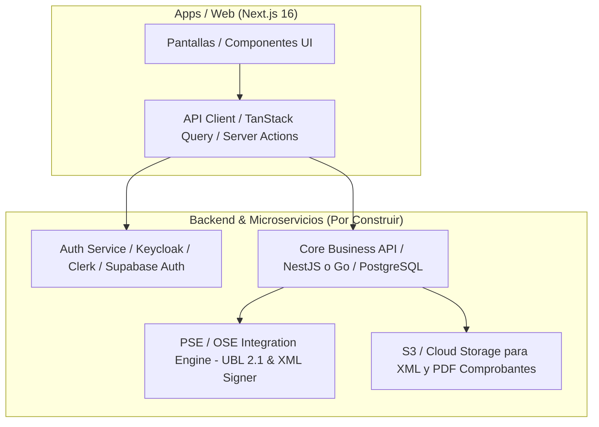

# Análisis Técnico y Funcional de Arquitectura: Wanka SaaS ERP Multi-Rubro (Perú)

**Autor:** Senior Full Stack Developer & Software Architect  
**Fecha de Análisis:** Noviembre 2026  
**Repositorio Local:** `D:\jose\Wanka`  
**Origen:** `https://github.com/bacsystem/wanka.git`  
**Licencia / Estado:** Proyecto Monorepo (pnpm workspace) en fase de Frontend UI/UX mock-backed de alta fidelidad, listo para integración con API/Backend.

---

## 1. Resumen Ejecutivo (Executive Summary)

**Wanka** es una plataforma **SaaS (Software as a Service) Cloud B2B multitenant** de gestión empresarial y facturación electrónica, diseñada específicamente para el ecosistema normativo, tributario y comercial de **Perú**.

A diferencia de los ERP genéricos internacionales (como Odoo, SAP Business One o Zoho) que requieren adaptaciones complejas para Perú, Wanka está modelado nativamente para resolver:
1. **Normativa Tributaria y Fiscal SUNAT:** Boletas, facturas, notas de crédito/débito, Guías de Remisión Electrónica (GRE Remitente/Transportista), Registro de Compras Electrónico (SIRE / RCE), Kardex Valorizado SUNAT 13.1 (promedio ponderado) y Liquidación preliminar PDT 621.
2. **Operación Multirrubro Adaptativa:** Un único núcleo transaccional capaz de cambiar su navegación, flujos y pantallas operativas de acuerdo a la industria del cliente (Restaurantes/Gastronomía, Clínicas Odontológicas/Médicas, Veterinarias y Retail/Comercio).
3. **Doble Capa de Aplicación:**
   - **Tenant Web App:** La aplicación que utilizan los clientes finales (las empresas inscritas).
   - **Super-Admin Console (Platform Admin):** Consola centralizada para los operadores del SaaS que permite gestionar inquilinos, monitorear la salud de enlaces OSE/SUNAT, controlar feature flags, soporte por tickets, facturación recurrente de suscripciones y telemetría.

Actualmente, el repositorio cuenta con una **arquitectura de frontend de primer nivel (Next.js 16 + React 19 + Tailwind v4 + Base UI / shadcn/ui)** con más de 370 pruebas E2E automatizadas, componentes modulares por características (*feature-based architecture*) y contratos de dominio definidos mediante tipos TypeScript y mocks de alta fidelidad, listos para acoplarse a microservicios o una API REST/GraphQL.

---

## 2. Para qué está Destinado el Sistema (Propósito y Mercado Objetivo)

### 2.1 Mercado Objetivo (Target Market)
- **Micro, Pequeñas y Medianas Empresas (MIPYMES) peruanas:** Negocios que necesitan formalizar o digitalizar su facturación, inventarios y caja sin incurrir en licencias costosas ni software obsoleto de escritorio.
- **Rubros Específicos Soportados Nativamente:**
  1. **Gastronomía y Restaurantes:** Salón interactivo, distribución de mesas en mapa visual, comandas a cocina (KDS - Kitchen Display System), gestión de pedidos delivery y reservas.
  2. **Veterinarias y Pet Shops:** Ficha de pacientes (mascotas), registro de propietarios, carné de vacunación digital, internamiento/hospitalización con control de caniles y signos vitales, módulo de grooming (peluquería canina/felina) y evolución clínica SOAP.
  3. **Clínicas Odontológicas y Consultorios Médicos:** Agenda de citas médicas, historia clínica digital y odontograma interactivo bajo la nomenclatura internacional FDI.
  4. **Retail y Comercio Minorista:** Punto de Venta (POS) ultrarrápido con soporte de lector de código de barras (F2 / EAN / SKU), matriz de variantes (tallas × colores) y múltiples almacenes.

### 2.2 Problemas Clave que Resuelve
- **Eliminación de multas tributarias:** Validación de estados de comprobantes ante SUNAT/OSE en tiempo real, alertas de inconsistencias en el SIRE y conciliación de compras/ventas.
- **Control Antifraude y Arqueo de Caja:** Gestión de turnos de cajero, aperturas, ingresos/egresos manuales, arqueos a ciegas y reportes de cierre Z.
- **Inventario Real vs. Teórico:** Control multialmacén, traslados internos sustentados con GRE, toma física de inventario para ajuste de mermas/descuadres y cálculo automático de costo promedio en Kardex 13.1.
- **Experiencia de Cobro Rápida (POS):** Venta en mostrador en menos de 3 clics con soporte de pagos mixtos (Efectivo, Tarjetas, Yape, Plin, Transferencia).

---

## 3. Stack Tecnológico y Arquitectura Técnica

### 3.1 Stack Tecnológico
| Capa | Tecnología | Versión | Justificación Técnica |
| :--- | :--- | :--- | :--- |
| **Monorepo Manager** | `pnpm` workspaces | 9.15.0 | Gestión eficiente de paquetes compartidos, deduplicación de dependencias por hardlinks y rendimiento superior a npm/yarn. |
| **Framework Web** | Next.js (App Router) | 16.3.5 | Server Components por defecto, renderizado ultrarrápido, rutas estáticas y dinámicas optimizadas. |
| **Librería UI** | React | 19.2.8 | Última generación de React (Action Hooks, Server Actions ready). |
| **Estilos & CSS** | Tailwind CSS | v4.0 | Motor CSS compilado ultrarrápido, variables nativas CSS para temas claro/oscuro y multi-marca. |
| **Componentes Base** | `@base-ui/react` + `shadcn/ui` | 1.8.0 / 4.21.0 | Accesibilidad WAI-ARIA nativa, controles sin estilos forzados (*headless*), altamente personalizables. |
| **Iconografía** | `lucide-react` | 1.45.0 | Consistencia visual, iconos dinámicos con microestados y sincronización de stroke width. |
| **Gráficos & BI** | `recharts` | 3.8.0 | Gráficos vectoriales SVG responsivos para KPIs de ventas, evolución de ingresos y métricas de soporte. |
| **Notificaciones** | `sonner` | 2.0.8 | Sistema de toasts moderno y accesible. |
| **Testing Unitario** | `vitest` + `@testing-library/react` | 5.0.0 | Pruebas de integración de componentes y lógica matemática/formateo a velocidad instantánea con JSDOM. |
| **Testing E2E** | `playwright` | 1.63.0 | Suite de pruebas de extremo a extremo automatizadas en 3 viewports: Desktop (1440px), Tablet (1024px) y Mobile (Pixel 7 / 390px). |

### 3.2 Arquitectura del Código (`apps/web/src`)
El proyecto sigue el patrón **Feature-Driven Architecture** (Arquitectura basada en funcionalidades):
```
apps/web/src/
├── app/                      # Rutas delgadas (Thin Routes / App Router)
│   ├── (admin)/              # Consola de administración SaaS (Super-Admin)
│   ├── (admin-auth)/         # Autenticación de administradores de plataforma
│   ├── (app)/                # Aplicación empresarial del inquilino (Tenant App)
│   └── (auth)/               # Autenticación del inquilino (Login, Onboarding, Switcher)
├── features/                 # Módulos de negocio aislados y desacoplados
│   ├── appointments/         # Citas y agenda
│   ├── auth/                 # Autenticación, sesión y cambio de tenant
│   ├── cash/                 # Caja, arqueo, turnos y reporte Z
│   ├── catalog/              # Productos, servicios, categorías y variantes
│   ├── clinical/             # Historias clínicas y odontograma interactivo
│   ├── customers/            # Directorio y ficha de clientes
│   ├── dashboard/            # Tableros ejecutivos e industry-dashboards
│   ├── dispatch-guides/      # Guías de remisión electrónicas (GRE)
│   ├── documents/            # Comprobantes electrónicos SUNAT (Facturas, Boletas, NC, ND)
│   ├── inventory/            # Almacenes, stock, movimientos, inventario físico y Kardex
│   ├── payables/             # Cuentas por pagar a proveedores
│   ├── platform-admin/       # Monitoreo global, suscripciones, soporte y auditoría SaaS
│   ├── pos/                  # Punto de venta y pasarela de cobro rápido
│   ├── purchases/            # Registro de compras SIRE y órdenes de compra
│   ├── quotes/               # Cotizaciones y proformas
│   ├── receivables/          # Cuentas por cobrar y crédito comercial
│   ├── reports/              # Reportes de gestión, tributarios y PDT 621
│   ├── restaurant/           # Mesas, KDS cocina, delivery y reservas
│   ├── retail/               # Matriz de variantes y código de barras
│   ├── settings/             # Configuración de empresa, series, SUNAT y usuarios
│   └── veterinary/           # Mascotas, internamiento, grooming y SOAP
├── components/               # Componentes UI reutilizables (shadcn, layout, shared)
├── config/                   # Configuración y navegación estática/dinámica
├── hooks/                    # Custom React Hooks
├── lib/                      # Utilidades de formato peruano (PEN S/, RUC, DNI, fechas)
└── types/                    # Definiciones de dominio TypeScript
```

---

## 4. Desglose Detallado de Módulos y Funcionalidades

### 4.1 Consola Super-Admin de la Plataforma (`/admin/*`)
Diseñada con una identidad visual propia (**Platform Indigo Theme** con barra lateral oscura):
- **Dashboard Central:** Métricas globales MRR (Monthly Recurring Revenue), ARR, churn rate, número de empresas activas y volumen de comprobantes emitidos en el mes.
- **Directorio de Empresas (Tenants):** Tabla con 1,482 inquilinos simulados, filtrado por estado de suscripción, plan contratado, RUC, rubro y límites de uso. Detalle individual con historial de facturación y logs de acceso.
- **Salud OSE / SUNAT:** Monitor en tiempo real de la latencia y tasa de error de los servidores de SUNAT y los Operadores de Servicios Electrónicos (OSE), con colas de reintento.
- **Soporte y Tickets:** Mesa de ayuda integrada para resolver incidencias de usuarios del SaaS clasificados por criticidad.
- **Planes y Suscripciones:** Gestión de planes (Emprendedor, Profesional, Corporativo), configuración de precios mensuales/anuales y cobros recurrentes.
- **Feature Flags y Módulos:** Activación/desactivación granular de módulos por cliente (por ejemplo, habilitar módulo restaurante solo a quienes lo pagan).
- **Auditoría Global:** Trazabilidad de operaciones de superadministradores con IP, agente y fecha/hora.

### 4.2 Núcleo Comercial y Facturación Electrónica SUNAT
- **POS (Point of Sale):**
  - Búsqueda predictiva de productos por nombre, SKU o lector de código de barras (F2).
  - Selector de cliente con autocompletado y consulta rápida de DNI/RUC.
  - Carrito con cálculo automático de valor de venta, IGV (18%), exoneraciones e inafectaciones.
  - Modal de cobro con múltiples medios de pago simultáneos y cálculo de vuelto.
- **Comprobantes Electrónicos (`/ventas/comprobantes`):**
  - **Factura Electrónica:** Para personas jurídicas con RUC 20/10, validación de razón social y dirección fiscal.
  - **Boleta de Venta:** Para consumidor final, validación de DNI si supera los límites normativos.
  - **Nota de Crédito:** Anulación de operaciones, corrección por error en RUC o descuento global.
  - **Nota de Débito:** Penalidades o intereses por mora (Catálogo 10 SUNAT).
  - **Proformas y Cotizaciones:** Generador en 3 pasos con plantillas imprimibles y conversión directa a venta en 1 clic.
  - **Guías de Remisión Electrónica (GRE):** Sustento de traslado de mercadería entre almacenes o a clientes, con datos de vehículo, conductor y modalidad de transporte (privado/público).

### 4.3 Inventario Multialmacén y Cadena de Suministro
- **Stock por Almacén:** Visibilidad de existencias físicas y disponibles en múltiples sedes (e.g., Almacén Principal, Tienda San Isidro, Almacén Callao).
- **Kardex 13.1:** Reporte oficial exigido por SUNAT bajo el método de valuación de inventarios **Promedio Ponderado**, registrando entradas, salidas y saldos en cantidad y valor monetario.
- **Movimientos de Almacén:** Entradas por compra, salidas por venta, mermas, traslados entre sedes y ajustes.
- **Toma de Inventario Físico:** Asistente para conteo ciego de existencias, cálculo de diferencias y generación de notas de ajuste automáticas.

### 4.4 Compras, Gastos y Finanzas
- **Registro de Compras (SIRE / RCE):** Módulo adaptado a la plataforma de la SUNAT para contrastar las propuestas de compras electrónicas RCE contra facturas de proveedores.
- **Cuentas por Cobrar (CxC):** Control de créditos otorgados a clientes, vencimientos a 30/60/90 días y cobros parciales.
- **Cuentas por Pagar (CxP):** Programación de pagos a proveedores, seguimiento de órdenes de compra pendientes de facturar.
- **Gestión de Caja y Turnos:** Apertura de caja con fondo inicial, registro de ingresos/egresos menores en efectivo, arqueo al cierre de turno y generación de reporte de liquidación Z.

### 4.5 Módulos Verticales por Rubro

#### A. Gastronomía (Restaurantes & Bares)
- **Mapa de Salón:** Vista de distribución de mesas por zonas (Planta Baja, Terraza, Barra), con estado en tiempo real (Libre, Ocupada, Cuenta solicitada, Reservada).
- **Comandas y Cocina (KDS):** Tablero kanban para cocina y bar que muestra pedidos por mesa, tiempo transcurrido en preparación y cambio de estado a listo/entregado.
- **Delivery y Reservas:** Gestión de pedidos para llevar o despacho a domicilio con asignación de motorizado y libro de reservas por horario y número de personas.

#### B. Veterinaria & Pet Care
- **Gestión de Pacientes:** Ficha médica de la mascota (nombre, especie, raza, peso, chip) asociada al propietario (cliente).
- **Carné de Vacunación:** Historial de vacunas aplicadas y calendario de refuerzos programados.
- **Hospitalización e Internamiento:** Visualización de caniles ocupados, monitoreo de signos vitales (temperatura, frecuencia cardíaca/respiratoria) y administración de medicación pautada.
- **Grooming:** Turnos de peluquería y baño canino con notas de corte y productos especiales.
- **Evolución Médica SOAP:** Notas clínicas estandarizadas (Subjetivo, Objetivo, Análisis, Plan).

#### C. Odontología & Salud
- **Odontograma FDI Interactivo:** Representación gráfica de la dentición de adultos y niños, con registro visual de caries, obturaciones, coronas, endodoncias y extracciones por pieza dental.
- **Historia Clínica y Presupuestos:** Registro de diagnósticos, plan de tratamiento por fases y evolución médica.

#### D. Retail
- **Gestión de Variantes:** Matriz bidimensional de tallas y colores que genera SKUs y códigos de barras individuales por cada combinación.
- **Venta por Escáner:** Agiliza el checkout en mostrador soportando lectores láser/ópticos estándar USB.

---

## 5. Calidad de Código, UI/UX y Sistema de Diseño

1. **Tokens de Diseño Estandarizados (Stitch v2 Kit):**
   - Paleta de color principal: **Andes Teal v2** (`#0D9488` teal oscuro, toques de ámbar `#F59E0B` para alertas y fondo neutro limpio `#F7F9FB`).
   - Modo Oscuro nativo con soporte `next-themes` y persistencia en cliente.
   - Controles de UI con altura uniforme de **40px** en inputs y botones primarios para máxima ergonomía táctil y visual.
2. **Componentes Clave Compartidos:**
   - `DataTable`: Componente de tabla empresarial con selector interactivo de columnas (visibilidad, fijado/freeze de columnas), ajuste de densidad visual y filtros.
   - `NumberInput`: Manejo preciso de inputs numéricos y decimales con soporte de coma decimal y parseo seguro sin saltos de cursor.
   - `DynamicIcon`: Iconos que reflejan el estado del sistema con animación y color semántico (OK, Warning, Error, Pending, Syncing, Offline).
3. **Responsive Design:**
   - **Desktop (>=1280px):** Barra lateral fija con submenús agrupados y tableros en cuadrícula balanceada.
   - **Tablet (768px - 1279px):** Barra lateral colapsada a iconos con tooltips accesibles.
   - **Mobile (<=767px):** Barra de navegación inferior (*BottomNav*), botón flotante (+ Nueva Venta) y transformación de tablas en tarjetas de datos compactas.

---

## 6. Estado Actual de Madurez y Hoja de Ruta (Roadmap)

### 6.1 Lo que está Completamente Resuelto (100%)
- Arquitectura de componentes, layout, navegación dinámica por rubro y sistema de diseño completo.
- Módulos funcionales de interfaz con validaciones locales, estados vacíos, modales y flujos interactivos.
- Cobertura de pruebas E2E robusta (Playwright) y pruebas unitarias (Vitest).
- Modelado de dominio en TypeScript exhaustivo (`types/domain.ts`).

### 6.2 Lo que Falta para Puesta en Producción (Brecha de Backend)
Actualmente, el sistema está respaldado por **mocks en memoria** y notificaciones toast simuladas. Para llevar Wanka a un producto comercial listo para producción, se requiere implementar:



1. **Persistencia y Base de Datos:**
   - Base de datos relacional PostgreSQL con aislamiento multitenant (estrategia de schema por tenant o `tenant_id` con Row-Level Security / RLS).
   - ORM / Query Builder: Prisma, Drizzle ORM o Kysely.
2. **Motor de Facturación Electrónica (SUNAT / UBL 2.1):**
   - Integración con Proveedor de Servicios Electrónicos (PSE) o desarrollo de módulo propio con firma digital de certificados `.pfx` / `.p12`, generación de XML UBL 2.1 y digest SHA-256, y recepción de Constancias de Recepción (CDR).
3. **Autenticación y Control de Accesos:**
   - JWT / Auth.js / Supabase Auth / Clerk con soporte de roles (Administrador, Vendedor, Cajero, Veterinario, Odontólogo, Cocinero).
4. **Motor de Impresión Térmica:**
   - Soporte para tickets de 80mm y 58mm vía ESC/POS en formato directo a impresoras de red o USB.

---

## 7. Dictamen Final del Desarrollador Senior

**Wanka es un proyecto de software de altísima calidad en su capa de frontend.** Representa una base de código moderna, limpia, mantenible y excepcionalmente bien orientada al negocio del mercado peruano. 

La separación de interfaces (Tenant App vs. Platform Admin), el diseño adaptativo multirrubro y el respeto estricto de las reglas fiscales de la SUNAT lo posicionan como un candidato de primer nivel para convertirse en un SaaS comercial líder en el Perú en cuanto se complete su capa de backend y persistencia.
