# Mapa de módulos del backend

Este mapa muestra el orden de construcción del backend: la prioridad de cada módulo, de qué depende y qué módulos se pueden construir en paralelo (por olas). El diseño técnico está en [`docs/architecture/`](../architecture/README.md), y cómo se toma una épica, en [`CONTRIBUTING.md`](../../CONTRIBUTING.md).

> **El avance vivo no está aquí.** Se ve en el Project público [Wanka · Mapa de módulos](https://github.com/users/bacsystem/projects/8) y en la barra de sub-issues de cada épica. Este gráfico solo cambia cuando cambian las prioridades o las dependencias.

## Niveles de prioridad

| Nivel | Significado |
|---|---|
| **P0** | Imprescindible para operar el núcleo (vender, emitir y cobrar). |
| **P1** | Necesario en el núcleo para la trazabilidad, pero no bloquea la operación. |
| **P2** | Amplía la operación: notificaciones, compras, reportes y los rubros lubricentro y librería. |
| **P3** | Plataforma, integraciones y los rubros posteriores. |

El código `P<nivel>-M<orden>` va en el título de cada épica. El orden es único (M00 a M21).

## Gráfico de dependencias

`A --> B` significa que B depende de A: A es un prerrequisito que B necesita para terminarse. `A -.-> B` es una dependencia parcial: solo algunas historias de B necesitan a A. Todo módulo depende del kernel (M00); en el gráfico solo se dibuja esa arista hacia la ola 1. Un módulo que abarca varias olas aparece en la ola en que empieza. Las olas se leen de arriba abajo, de la 0 a la 6.

```mermaid
flowchart TB
  subgraph O0["Ola 0 · kernel"]
    M00["P0-M00 kernel"]
  end
  subgraph O1["Ola 1"]
    M01["P0-M01 identidad"]
    M02["P0-M02 empresas"]
  end
  subgraph O2["Ola 2"]
    M03["P0-M03 catalogo"]
    M04["P0-M04 clientes"]
    M05["P0-M05 finanzas (2-5)"]
    M06["P0-M06 facturacion-electronica (2-3)"]
    M09["P1-M09 auditoria"]
  end
  subgraph O3["Ola 3"]
    M07["P0-M07 inventario"]
    M08["P0-M08 ventas"]
    M12["P2-M12 reportes (3-5)"]
  end
  subgraph O4["Ola 4"]
    M10["P2-M10 notificaciones"]
    M11["P2-M11 compras (4-5)"]
    M16["P2-M16 lubricentros"]
    M17["P2-M17 librerías"]
  end
  subgraph O5["Ola 5"]
    M13["P3-M13 integraciones"]
  end
  subgraph O6["Ola 6"]
    M14["P3-M14 plataforma"]
    M15["P3-M15 agenda"]
    M18["P3-M18 restaurantes"]
    M19["P3-M19 veterinarias"]
    M20["P3-M20 odontologías"]
    M21["P3-M21 retail"]
  end

  M00 --> M01
  M00 --> M02
  M02 --> M01
  M01 --> M02
  M02 --> M03
  M02 --> M04
  M02 --> M05
  M02 --> M06
  M07 -.-> M06
  M01 --> M09
  M03 --> M07
  M02 --> M07
  M03 --> M08
  M04 --> M08
  M07 --> M08
  M02 --> M08
  M06 --> M08
  M05 --> M08
  M02 --> M12
  M08 -.-> M12
  M06 -.-> M12
  M07 -.-> M12
  M11 -.-> M12
  M05 -.-> M12
  M04 -.-> M12
  M01 --> M10
  M06 --> M10
  M13 -.-> M10
  M03 --> M11
  M07 --> M11
  M02 --> M11
  M05 -.-> M11
  M08 --> M16
  M03 --> M16
  M07 --> M16
  M10 -.-> M16
  M03 --> M17
  M07 --> M17
  M08 --> M17
  M01 --> M13
  M08 -.-> M13
  M06 -.-> M13
  M02 --> M14
  M01 --> M14
  M06 -.-> M14
  M04 --> M15
  M03 --> M15
  M08 --> M15
  M08 --> M18
  M03 --> M18
  M04 --> M19
  M15 --> M19
  M04 --> M20
  M15 --> M20
  M03 --> M21
  M08 --> M21

  O3 ~~~ O4
  O4 ~~~ O5
  O5 ~~~ O6

  classDef p0 fill:#cf222e,stroke:#82071e,color:#ffffff
  classDef p1 fill:#bc4c00,stroke:#762c00,color:#ffffff
  classDef p2 fill:#d4a72c,stroke:#7d4e00,color:#1f2328
  classDef p3 fill:#6e7781,stroke:#424a53,color:#ffffff
  class M00,M01,M02,M03,M04,M05,M06,M07,M08 p0
  class M09 p1
  class M10,M11,M12,M16,M17 p2
  class M13,M14,M15,M18,M19,M20,M21 p3

  click M00 "https://github.com/bacsystem/wanka/issues/154" "Épica M00 · Kernel"
  click M01 "https://github.com/bacsystem/wanka/issues/3" "Épica identidad"
  click M02 "https://github.com/bacsystem/wanka/issues/4" "Épica empresas"
  click M03 "https://github.com/bacsystem/wanka/issues/6" "Épica catálogo"
  click M04 "https://github.com/bacsystem/wanka/issues/5" "Épica clientes"
  click M05 "https://github.com/bacsystem/wanka/issues/11" "Épica finanzas"
  click M06 "https://github.com/bacsystem/wanka/issues/9" "Épica facturación electrónica"
  click M07 "https://github.com/bacsystem/wanka/issues/7" "Épica inventario"
  click M08 "https://github.com/bacsystem/wanka/issues/8" "Épica ventas"
  click M09 "https://github.com/bacsystem/wanka/issues/15" "Épica auditoría"
  click M10 "https://github.com/bacsystem/wanka/issues/16" "Épica notificaciones"
  click M11 "https://github.com/bacsystem/wanka/issues/10" "Épica compras"
  click M12 "https://github.com/bacsystem/wanka/issues/12" "Épica reportes"
  click M13 "https://github.com/bacsystem/wanka/issues/14" "Épica integraciones"
  click M14 "https://github.com/bacsystem/wanka/issues/17" "Épica plataforma"
  click M15 "https://github.com/bacsystem/wanka/issues/13" "Épica agenda"
  click M16 "https://github.com/bacsystem/wanka/issues/18" "Épica lubricentros"
  click M17 "https://github.com/bacsystem/wanka/issues/19" "Épica librerías"
  click M18 "https://github.com/bacsystem/wanka/issues/20" "Épica restaurantes"
  click M19 "https://github.com/bacsystem/wanka/issues/21" "Épica veterinarias"
  click M20 "https://github.com/bacsystem/wanka/issues/22" "Épica odontologías"
  click M21 "https://github.com/bacsystem/wanka/issues/23" "Épica retail"
```

Colores: P0 rojo, P1 naranja, P2 amarillo, P3 gris. GitHub puede ignorar los `click` del diagrama; la tabla de abajo tiene los mismos enlaces.

## Módulos

Dependencias fuertes en «Depende de»; las parciales van entre paréntesis.

| Código | Épica | Ola | Depende de | Motivo |
|---|---|---|---|---|
| P0-M00 | [#154 Kernel](https://github.com/bacsystem/wanka/issues/154) · hecho (v0.19.0) | 0 | — | `apps/api`, `InTenantTx`, middleware auth → tenant → entitlements → RBAC → idempotencia, esquema `ops`, escritor de auditoría, `pricing.Compute`, plan semilla y catálogo de permisos sembrado |
| P0-M00b | [#225 Seguimientos del kernel](https://github.com/bacsystem/wanka/issues/225) | 0 | — | hallazgos menores de las revisiones del kernel (auditoría, idempotencia, guardas); no bloquea la ola 1 |
| P0-M01 | [#3 Identidad y accesos](https://github.com/bacsystem/wanka/issues/3) · en curso (v0.20.0: DDL #231 y #232, permisos #233, login #24) | 1 | empresas | memberships y membership_sites referencian tenants y sites; la sesión se liga a la caja ([er-01](../architecture/data/er-01-identidad-empresas.mmd), [data-model §3](../architecture/data/data-model.md)) |
| P0-M02 | [#4 Empresas](https://github.com/bacsystem/wanka/issues/4) · en curso; contrato del alta hecho (#256) | 1 | identidad | el alta de empresa (#31) crea la membresía del dueño. Es el único ciclo: se corta fijando el DDL de `iam` y `org` en la ola 0 |
| P0-M03 | [#6 Catálogo](https://github.com/bacsystem/wanka/issues/6) | 2 | empresas | solo tenant y RBAC; las variantes son core del catálogo |
| P0-M04 | [#5 Clientes](https://github.com/bacsystem/wanka/issues/5) | 2 | empresas | solo tenant y RBAC |
| P0-M05 | [#11 Finanzas y caja](https://github.com/bacsystem/wanka/issues/11) | 2-5 | empresas | la caja usa `cash_registers` y la serie Z; la CxC y la CxP (ola 5) las alimentan ventas y compras por la fachada de finanzas |
| P0-M06 | [#9 Facturación electrónica](https://github.com/bacsystem/wanka/issues/9) | 2-3 | empresas (inventario) | numera con `org.document_series`; la base con Khipu va en la ola 2 y la emisión en la 3; la GRE (#61) es de R2 (ola 4) y necesita los traslados |
| P0-M07 | [#7 Inventario](https://github.com/bacsystem/wanka/issues/7) | 3 | catálogo, empresas | `stock_levels` y `stock_movements` referencian `item_variants`; la consignación (#112) ve los proveedores por un puerto que implementa compras |
| P0-M08 | [#8 Ventas y POS](https://github.com/bacsystem/wanka/issues/8) | 3 | catálogo, clientes, inventario, empresas, facturación, finanzas | la venta POS es una sola transacción que descuenta stock, numera, crea el CPE pendiente y exige el turno abierto ([ADR 0002](../architecture/adr/0002-modular-monolith-go.md)) |
| P1-M09 | [#15 Auditoría](https://github.com/bacsystem/wanka/issues/15) | 2 | identidad | el escritor está en el kernel; la bitácora y el historial de accesos (#79, #80) leen sesiones |
| P2-M10 | [#16 Notificaciones](https://github.com/bacsystem/wanka/issues/16) | 4 | identidad, facturación (integraciones) | envía comprobantes con su PDF (#81), invitaciones y restablecimientos; WhatsApp usa el conector de integraciones |
| P2-M11 | [#10 Compras](https://github.com/bacsystem/wanka/issues/10) | 4-5 | catálogo, inventario, empresas (finanzas) | la recepción (#65) mueve stock y la OC usa la serie OC; la CxP (#70) va a finanzas |
| P2-M12 | [#12 Reportes](https://github.com/bacsystem/wanka/issues/12) | 3-5 | empresas (ventas, facturación, inventario, compras, finanzas, clientes) | solo lectura sobre los demás módulos; el dashboard #71 va en la ola 3 y el resto en la 5 |
| P3-M13 | [#14 Integraciones](https://github.com/bacsystem/wanka/issues/14) | 5 | identidad (ventas, facturación) | claves de API (#78); los webhooks salientes consumen eventos de ventas y facturación |
| P3-M14 | [#17 Plataforma SaaS](https://github.com/bacsystem/wanka/issues/17) | 6 | empresas, identidad (facturación) | administra `org.tenants` con `platform_rw` ([ADR 0001](../architecture/adr/0001-multitenancy-rls.md)); el monitoreo (#89) lee la facturación; los entitlements y el plan semilla van en el kernel |
| P3-M15 | [#13 Agenda](https://github.com/bacsystem/wanka/issues/13) | 6 | clientes, catálogo, ventas | las citas usan clientes y servicios; cobrar una cita (#76) pasa por el POS |
| P2-M16 | [#18 Rubro lubricentros](https://github.com/bacsystem/wanka/issues/18) | 4 | ventas, catálogo, inventario (notificaciones) | la OT se cobra como venta y reserva stock; el recordatorio de cambio (#101) se envía por notificaciones |
| P2-M17 | [#19 Rubro librerías](https://github.com/bacsystem/wanka/issues/19) | 4 | catálogo, inventario, ventas | los libros extienden ítems 1:1; las listas escolares reservan stock y se cotizan |
| P3-M18 | [#20 Rubro restaurantes](https://github.com/bacsystem/wanka/issues/20) | 6 | ventas, catálogo | mesas, comandas y delivery terminan en una venta |
| P3-M19 | [#21 Rubro veterinarias](https://github.com/bacsystem/wanka/issues/21) | 6 | clientes, agenda | las mascotas cuelgan del cliente; consultas y grooming se agendan |
| P3-M20 | [#22 Rubro odontologías](https://github.com/bacsystem/wanka/issues/22) | 6 | clientes, agenda | la historia clínica cuelga del paciente; las citas usan la agenda |
| P3-M21 | [#23 Rubro retail](https://github.com/bacsystem/wanka/issues/23) | 6 | catálogo, ventas | la matriz talla×color y los cambios sobre ventas |

## Olas y contratos que se fijan antes de abrirlas

Una ola se abre cuando su contrato está publicado en la épica, para que el módulo que lo ofrece y el que lo usa trabajen en paralelo con dobles de prueba. La fuente final es [`apps/api/openapi/openapi.yaml`](../../apps/api/openapi/openapi.yaml) y sus `paths/<módulo>.yaml`. Las fachadas que se nombran aquí (`NextNumber`, `Decrement`, `CreatePending`) salen del [ADR 0002](../architecture/adr/0002-modular-monolith-go.md) y de [data-model §3-4](../architecture/data/data-model.md); el orden de las olas, las firmas exactas, las fachadas de finanzas y el puerto `Mailer` son propuesta, pendiente de ADR.

- **Ola 0 (kernel, un solo equipo).** [`api/conventions.md`](../architecture/api/conventions.md) (cursor, errores RFC 9457, dinero como string, idempotencia) y el catálogo de permisos completo ([`api/resources.md`](../architecture/api/resources.md), «Catálogo de permisos»). **Cerrada el 2026-11-19 (v0.19.0).** Las verificaciones en BETA de Khipu (redondeo y correlativo N+1) pasaron a #224, dentro de facturación (ola 2), y bloquean #56. Los hallazgos menores del kernel están en #225 y no bloquean la ola 1.
- **Ola 1 (identidad ∥ empresas).** El DDL de `org.tenants`, `sites`, `cash_registers`, `document_series` y `tenant_settings`; `/v1/auth/*`, `/v1/auth/session/tenant` y `/v1/me/entitlements`; la firma de `empresas.NextNumber(ctx, tx, cashRegisterID, docType)`. Con las columnas de sincronización con Khipu y el job `einv.company_sync` del [ADR 0013](../architecture/adr/0013-khipu-company-config-sync.md) (2026-11-19): su tipo de argumentos va en el paquete de jobs del kernel, para que empresas lo encole sin importar facturación. El correo va detrás de un puerto `Mailer` con un stub hasta la ola 4.
- **Ola 2 (catálogo ∥ clientes ∥ caja ∥ auditoría ∥ base de facturación).** El DTO de `facturacion.CreatePending`; `finanzas.AssertShiftOpen` y `finanzas.RecordPayment`; las tablas `items`, `item_variants` y `customers`, a las que apuntan las FK compuestas de la ola 3.
- **Ola 3 (inventario ∥ ventas ∥ emisión ∥ dashboard).** `inventario.Decrement` y `inventario.Reserve`, con locks en orden de `variant_id`; `POST /v1/sales` y `GET /v1/einvoicing/documents` (ya en el esqueleto del openapi).
- **Ola 4 (notificaciones ∥ compras ∥ lubricentros ∥ librerías ∥ GRE, todo R2).** La fachada de proveedores (#62) antes de la consignación (#112); los traslados (#44) antes de la GRE (#61); el puerto de envío de notificaciones.
- **Ola 5 (CxC y CxP ∥ reportes ∥ integraciones).** Las vistas o fachadas de lectura de `rpt` y el catálogo de eventos de los webhooks salientes.
- **Ola 6 (plataforma ∥ agenda ∥ rubros).** `/platform/v1` ([`api/resources.md`](../architecture/api/resources.md), «Plano plataforma») y `GET /v1/agenda/resources` y `appointments`.

## Recursos compartidos que obligan a serializar

En la columna «Respaldo», una regla con enlace ya está en los docs de arquitectura; una marcada «propuesta, pendiente de ADR» la propone este mapa y no rige hasta registrarse en [`docs/architecture/`](../architecture/README.md) (§9).

| Recurso | Riesgo | Cómo se corta | Respaldo |
|---|---|---|---|
| Migraciones (goose) | dos ramas con el mismo número de versión chocan al mergear | solo hacia adelante y cambios destructivos en expandir → migrar → contraer | [data-model §6](../architecture/data/data-model.md#6-migraciones) |
| | | versiones con timestamp, un solo dueño por esquema y FK entre esquemas solo hacia tablas de olas anteriores | propuesta, pendiente de ADR |
| `org.document_series` | es una fila caliente que usan facturación, ventas, compras, finanzas y lubricentros | todo lo que no necesita el lock va antes; el `UPDATE` de la serie es la penúltima sentencia, justo antes de los `INSERT` del documento y del `COMMIT`, sin llamadas de red dentro; una serie por caja | [data-model §3](../architecture/data/data-model.md#3-series-y-correlativos-numeración-concurrente) |
| | | acceso solo por `empresas.NextNumber` | [ADR 0002](../architecture/adr/0002-modular-monolith-go.md) (fachadas y transacción compartida) |
| | | el `CHECK` de `doc_type` se siembra completo desde el inicio (01, 03, 07, 08, 09, PRO, OC, Z, OT) | propuesta, pendiente de ADR |
| Catálogo de permisos | un solo archivo y una sola semilla en `iam` | los códigos salen solo del catálogo | [`api/resources.md`](../architecture/api/resources.md#catálogo-de-permisos-fuente-de-verdad) |
| | | se congela en la ola 0; una alta posterior es un PR a `api/resources.md` más su migración, a cargo de identidad | propuesta, pendiente de ADR |
| RLS | las funciones `SECURITY DEFINER` y las políticas extra cambian `rls-check` | toda tabla de tenant usa la política estándar; un cambio de políticas, roles, grants o funciones definer actualiza `rls-check` y pasa `sh docs/architecture/data/rls-check/run.sh` | [data-model §1](../architecture/data/data-model.md#1-reglas-comunes-a-toda-tabla-de-tenant), [ADR 0001](../architecture/adr/0001-multitenancy-rls.md) |
| | | login, webhooks, alta de tenant y `platform_rw` se cambian de a uno | propuesta, pendiente de ADR |
| `openapi.yaml` | un solo archivo editado por todos | partido por tag: `apps/api/openapi/paths/<módulo>.yaml` (uno por código de `platform.modules`, unidos por `$ref`) y un paquete generado por módulo en `internal/apigen/` | hecho, #166 ([ADR 0009](../architecture/adr/0009-api-contract-openapi.md)) |
| Transacción de la venta POS | cruza cinco fachadas; un orden de locks distinto produce deadlocks | primero el stock, en orden de `variant_id`; después el `UPDATE` de la serie, justo antes de los `INSERT` del documento y del `COMMIT` | [data-model §4](../architecture/data/data-model.md#4-stock) y [§3](../architecture/data/data-model.md#3-series-y-correlativos-numeración-concurrente) |
| | | ventas es dueño de la prueba integrada y de ese orden | propuesta, pendiente de ADR |
| `org.tenant_settings` | varias configuraciones leídas por varios módulos | solo empresas la escribe; los demás la leen por su fachada | propuesta, pendiente de ADR |

## Decisiones pendientes del dueño

- ~~Librerías Go (River, sqlc, goose, oapi-codegen, shopspring/decimal, pquerna/otp, OpenTelemetry, SDK de S3)~~ **Decidido (2026-11-17):** el dueño las aprobó y el [ADR 0002](../architecture/adr/0002-modular-monolith-go.md) quedó aceptado; ya no bloquean la ola 0.
- ~~Mover #61 (GRE) a R2~~ **Decidido (2026-11-17):** la GRE pasa a R2, en la ola 4 (ADR 0003).
- **Milestone de deuda técnica** para los issues de plataforma y frontend sin milestone (por ejemplo #123, #132, #140, #141, #145, #148), fuera de las épicas.
- ~~Paginación por cursor o numerada~~ **Decidido (2026-11-18):** cursor en todos los listados ([`api/conventions.md`](../architecture/api/conventions.md) §5); `PaginationBar` pasa a anterior/siguiente en #178.
- **Stock negativo** (`allow_negative_stock`): define el descuento de stock de la ola 3 ([data-model §4](../architecture/data/data-model.md)).
